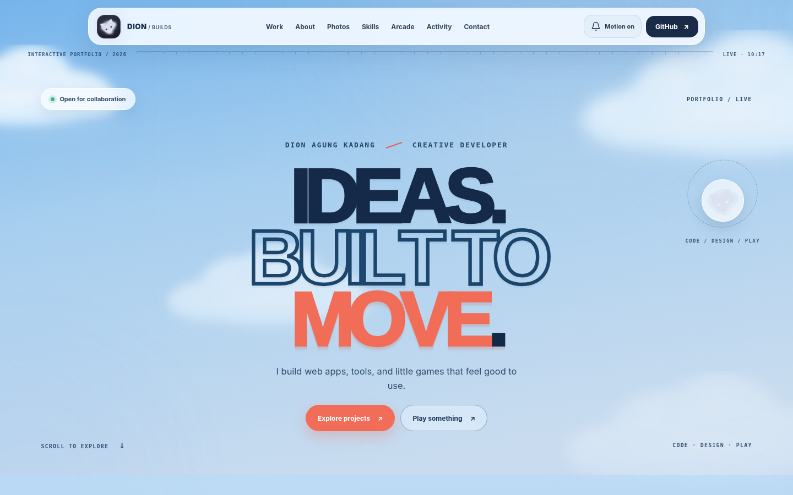
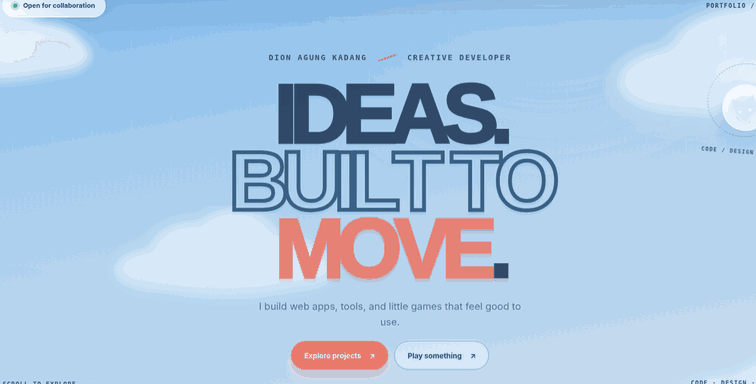
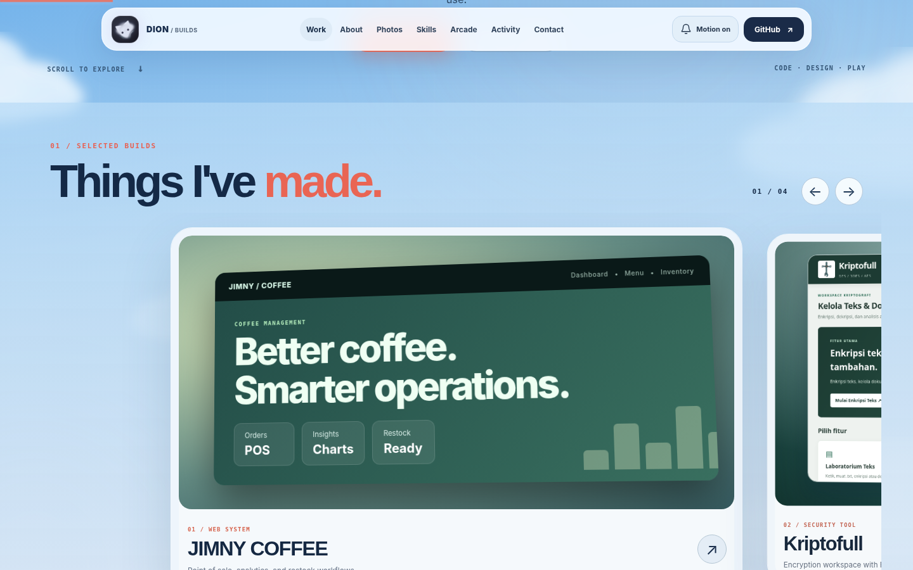
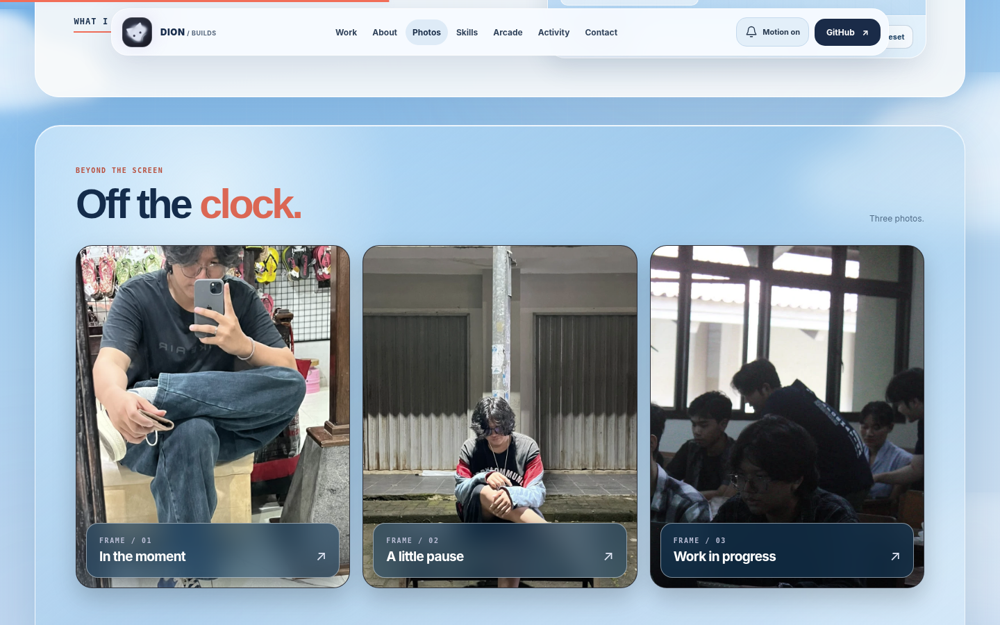
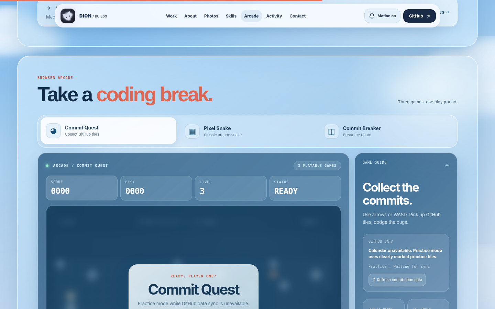
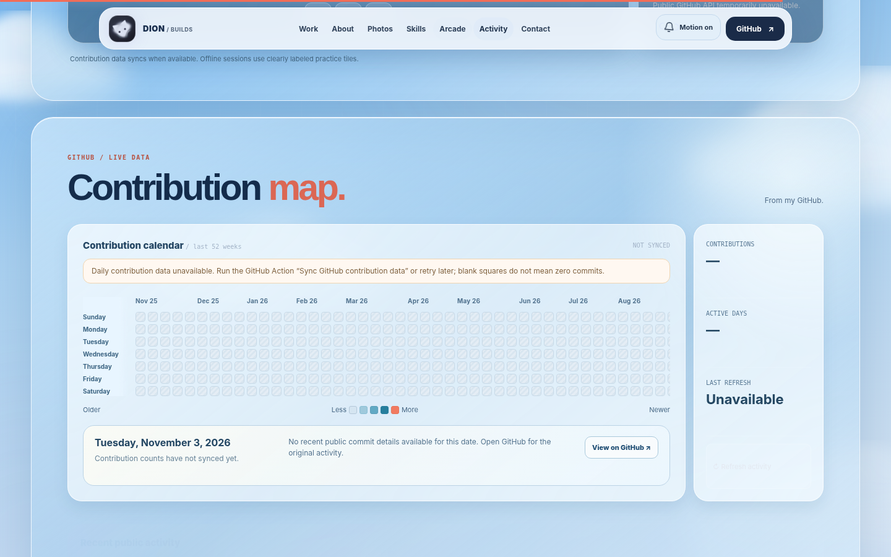

<div align="center">

# SKYBOUND

**Dion Agung Kadang · Interactive Developer Portfolio**

[Website](https://dion1727.github.io/) · [GitHub](https://github.com/dion1727) · [Projects](https://github.com/dion1727?tab=repositories)



</div>

## Live editing saat scroll

Judul tiap bagian **berawal kecil**, lalu **membesar mengikuti arah scroll**. Cursor editor bergerak seperti sedang menarik handle, dan bingkai menghilang saat ukuran mencapai 100%. Saat scroll naik, proses berjalan terbalik dengan halus.

<div align="center"></div>

## Lihat tampilannya

<table>
<tr><td width="50%"><br><b>Work</b> — empat project dalam carousel yang bisa digeser.</td>
<td width="50%"><br><b>Photos</b> — tiga foto personal, spotlight dan lightbox.</td></tr>
<tr><td width="50%"><br><b>Arcade</b> — Commit Quest, Pixel Snake, Commit Breaker.</td>
<td width="50%"><br><b>Activity</b> — kalender tanggal dan aktivitas publik ketika data tersedia.</td></tr>
</table>

## Interaksi

- Awan bergerak, teks hero bereaksi terhadap cursor, efek sparkle yang tidak menghalangi klik.
- **Live editing** untuk judul Work, About, Photos, Skills, Arcade, Activity, dan Contact; cursor editor bergerak seiring pembesaran.
- Carousel project, kartu 3D, efek spotlight dan hover pada foto.
- Playground bola dengan drag, gravity, tambah bola, dan reset.
- Tiga game JavaScript yang benar-benar dapat dimainkan, termasuk papan kontribusi.
- Tombol **Motion on/off** untuk efek gerak, dukungan `prefers-reduced-motion`, serta layout responsif.
- Tautan GitHub, LinkedIn, Kaggle, Instagram, YouTube, Discord, dan Email seperti versi portofolio sebelumnya.

## Jalankan di komputer

Website ini **HTML, CSS, JavaScript**; tidak membutuhkan npm, React, atau server backend.

Buka folder ini di VS Code, lalu jalankan `JALANKAN_WEBSITE_LOKAL.bat`. Atau gunakan terminal:

```powershell
py -m http.server 8000
```

Buka **http://localhost:8000/**. Jika port 8000 sedang digunakan, hentikan server lain atau gunakan port berbeda.

## Publikasikan ke GitHub Pages

1. Clone repository `dion1727.github.io` di GitHub Desktop.
2. Coba website secara lokal dan backup versi yang sedang online.
3. Salin **isi folder project ini** ke root repository, tidak termasuk folder pembungkus atau file ZIP.
4. Cek tab **Changes**, commit, lalu **Push origin**. Bila ada commit baru di GitHub, lakukan Fetch/Pull terlebih dahulu dan selesaikan konflik jika muncul.
5. Pastikan **Settings → Pages → Deploy from a branch → `main` / `(root)`**.
6. Buka [dion1727.github.io](https://dion1727.github.io/). Bila masih lama, gunakan **Ctrl + Shift + R**.

## Privasi: apa yang dibersihkan dan dipertahankan

**Sesuai permintaan pemilik, tiga foto asli dan tautan sosial tetap ada.** Foto `assets/moment-1.webp` sampai `moment-3.webp` memang dimaksudkan tampil di halaman publik. Pengunjung GitHub Pages dapat melihat atau mengunduhnya. Foto ketiga juga menampilkan orang lain; pastikan boleh dipublikasikan.

Paket ini tidak menyertakan file konfigurasi rahasia komputer, token, database lokal, cache, password, rekaman, atau hasil transkrip. `.gitignore` membatasi file lokal yang tidak boleh terunggah. Tidak ada informasi direktori pribadi Windows di source project.

> **Penting:** `.gitignore` tidak menghapus file sensitif yang *pernah* di-commit sebelumnya. Periksa riwayat Git dan ikuti [PUBLIC_RELEASE_CHECKLIST.md](PUBLIC_RELEASE_CHECKLIST.md) sebelum publikasi.

## Berkas utama

```text
index.html                 Website utama
styles.css, skybound.css   Tampilan dasar dan awan
collab-motion-v14.css      Bingkai editor & gerakan visual
collab-scroll-v14.js       Resize teks mengikuti scroll
site.js, skybound.js       Navigasi, interaksi dan carousel
cursor-v11.js             Sparkle cursor
orbit-playground.js        Playground bola
game.js                    Ketiga game
radar.js                   Contribution activity
data/                      Data kontribusi publik
assets/                    Logo, screenshot project, tiga foto personal
docs/previews/             Screenshot dan animasi README
```

`components/ui/` berisi komponen React sebagai **referensi**, bukan dependensi website statis ini.

<div align="center"><sub>Code • Build • Play · @dion1727</sub></div>
