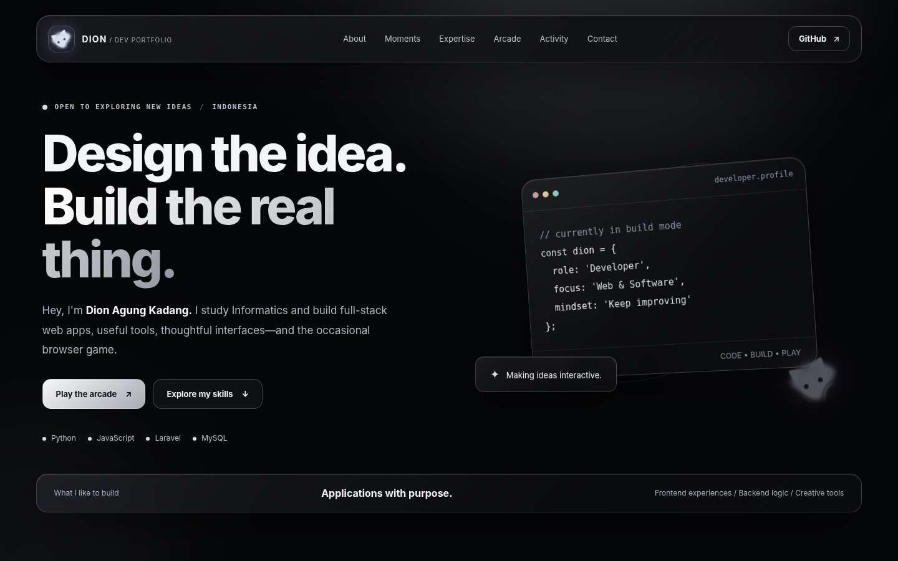
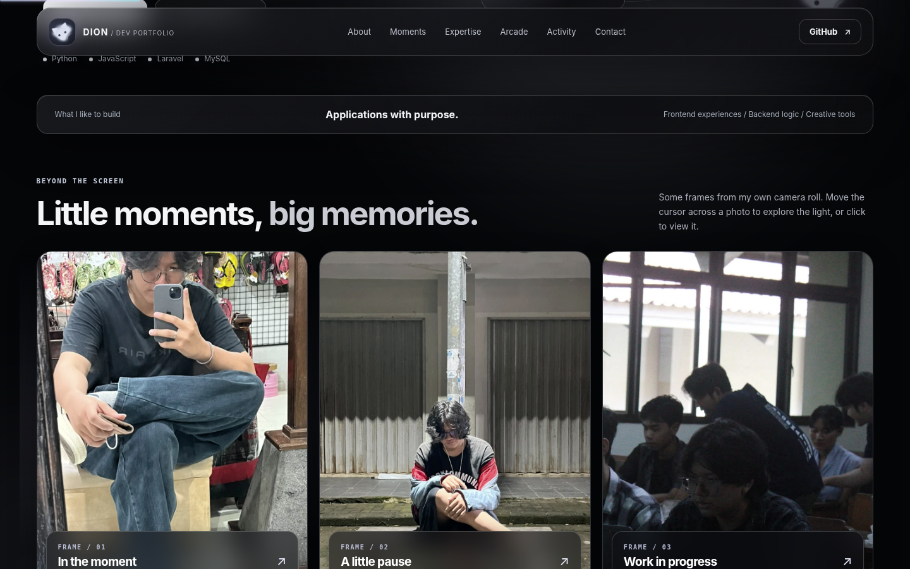
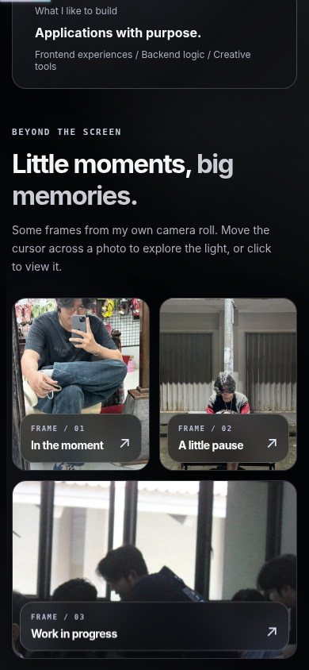

# Dion / Developer Portfolio + Playable Arcade

Black-glass portfolio yang telah direvisi dengan **logo kucing**, tiga foto pribadi, dan interaksi cursor.

## Preview







## Tampilan

- Logo kucing di navbar dari gambar yang diberikan.
- Galeri tiga foto pribadi, dengan spotlight mengikuti mouse dan preview modal klik.
- Scroll animation di seluruh section (hero, foto, skill, game, GitHub activity, media sosial), parallax ringan, progress bar scroll, serta cursor glow dengan trail halus dan label interaktif yang mengikuti mouse.
- Tetap mempertahankan **Commit Quest, Pixel Snake, Commit Breaker, GitHub Activity, keahlian, dan media sosial**.
- Responsive desktop dan mobile; mengikuti preferensi reduced motion.

## Update Motion V2

- **Scroll reveal** pada judul, kartu, studio game, kontribusi, kontak; gerakan naik/menyamping + blur lembut dengan `IntersectionObserver`.
- **Cursor glow** selalu mengikuti pointer mouse dengan ring transparan dan trail halus; di tombol yang memakai `data-intent` berubah menjadi label aksi.
- **Spotlight** pada tiga foto, kartu keahlian, sosial, dan panel game/GitHub.
- **Parallax ringan** di hero yang bergerak berdasarkan posisi scroll.
- Animasi tidak mengubah `game.js` atau `radar.js`, agar game dan fetch kontribusi tetap berfungsi.
- Efek otomatis tidak aktif di layar sentuh atau bila pengaturan *Reduced Motion* dinyalakan.

## Menjalankan

Bisa langsung dibuka lewat `index.html`, tetapi lebih baik dengan server lokal:

```bash
python -m http.server 8000
```

Buka `http://localhost:8000/`. Untuk Windows, juga bisa jalankan `JALANKAN_WEBSITE_LOKAL.bat`.

## Publikasi GitHub Pages

Upload **isi folder ini** ke root repository `dion1727/dion1727.github.io`, bukan folder pembungkusnya. Pastikan `index.html` berada di root, lalu aktifkan GitHub Pages: `main` / `(root)` atau gunakan workflow Pages sesuai konfigurasi repo.

GitHub API dapat membatasi permintaan; status gagal mengambil data harus tetap dianggap tidak tersedia, bukan dibuat-buat.

## Komponen React

Proyek saat ini adalah HTML/JS, bukan React. Source Spotlight TSX dan Intent Label tersedia di `components/ui/`; baca [REACT_SHADCN_SETUP.md](REACT_SHADCN_SETUP.md) untuk memasangnya di proyek React + Tailwind + TypeScript melalui CLI shadcn. Website HTML sekarang memakai efek spotlight ekuivalen **yang sudah berjalan** tanpa membutuhkan NPM.

> **Privasi:** tiga foto yang diberikan berada di `assets/moment-*.webp`. Jika repository disetel Public, gambar tersebut akan bisa dilihat oleh siapa pun. Periksa sebelum upload.
