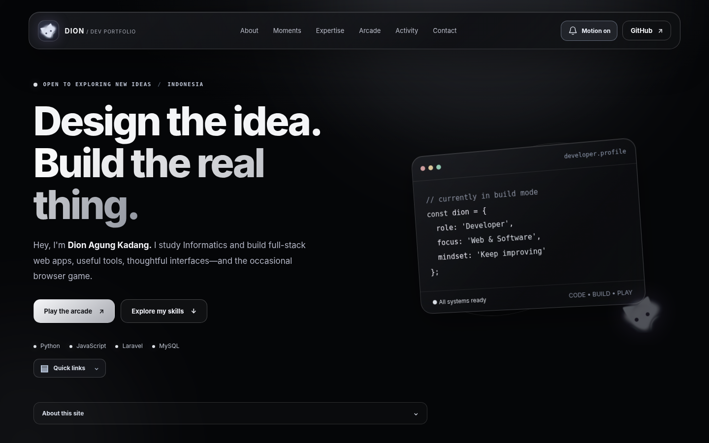
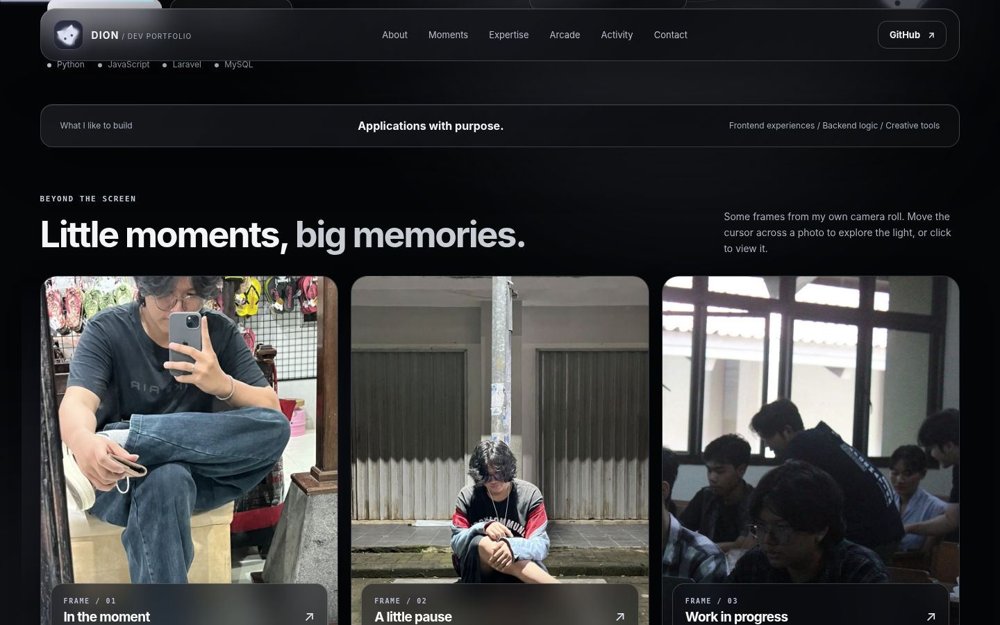
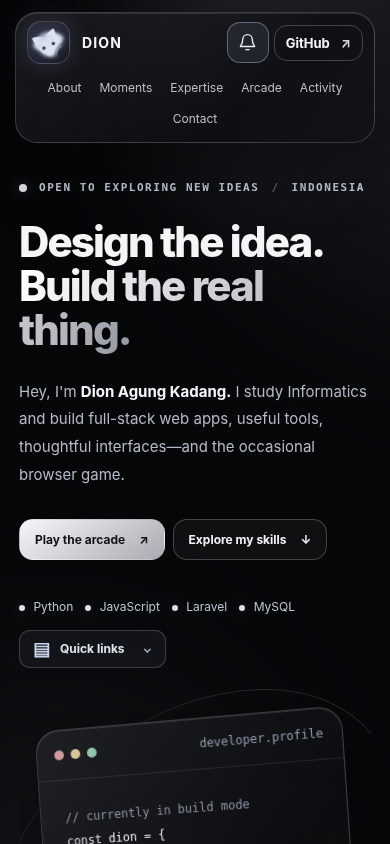

# Dion — Portfolio & Arcade

Portfolio web dengan tema **black glass**, logo kucing, tiga foto, dan game interaktif. Ini versi revisi berdasarkan **V2 asli**, bukan desain ulang yang menghilangkan komponen.



## Yang tersedia

- Halaman About, Moments (tiga foto dan preview), Expertise, Arcade, GitHub Activity, dan Contact.
- **Commit Quest**, **Pixel Snake**, dan **Commit Breaker** yang dapat dimainkan dengan keyboard ataupun tombol arah.
- Data kontribusi GitHub bila tersedia; fallback practice dibedakan dari kontribusi asli.
- Tautan sosial dan galeri personal tetap tersedia.
- **Repeated scroll reveal**: animasi muncul kembali ketika bagian halaman masuk layar dari atas ataupun bawah.
- **Background cursor swarm**: cahaya/partikel lembut mengikuti mouse **di belakang konten**; tombol dan teks tidak tertimpa.
- **Spotlight hover**, **magnetic buttons**, dan **Quick links** berupa folder animasi.
- **Motion on/off**: tombol animasi dengan fungsi nyata untuk menyalakan atau menghentikan efek gerak.
- Footer cinematic yang lebih tenang, tanpa slogan berlebihan.





## Jalankan di VS Code

Jalankan `JALANKAN_WEBSITE_LOKAL.bat` pada Windows, atau:

```powershell
py -m http.server 8000
```

Lalu buka http://localhost:8000/. Agar tidak kehilangan perubahan, coba di folder baru terlebih dahulu, jangan overwrite repository online sebelum diperiksa.

## Upload ke GitHub Pages

Salin **isi folder project** ke root repository `dion1727.github.io` (pastikan `index.html` ada di root). Commit dan Push via GitHub Desktop. Gunakan Ctrl+Shift+R sesudah Pages ter-deploy untuk memaksa refresh aset CSS/JS.

## React Bits / shadcn

Website aktif tidak membutuhkan React/npm. Kode sumber React Bits yang kamu lampirkan disimpan sebagai referensi di `components/ui/`, sedangkan versi adaptasi yang berfungsi pada website ada di `site.js` dan `styles.css`. Untuk Next.js + TypeScript + Tailwind + shadcn, lihat [REACT_SHADCN_SETUP.md](REACT_SHADCN_SETUP.md).

**Privasi:** ketiga foto di `assets/moment-*.webp` akan dapat diakses publik apabila repository diunggah sebagai Public. Tinjau kembali link media sosial sebelum publikasi.
