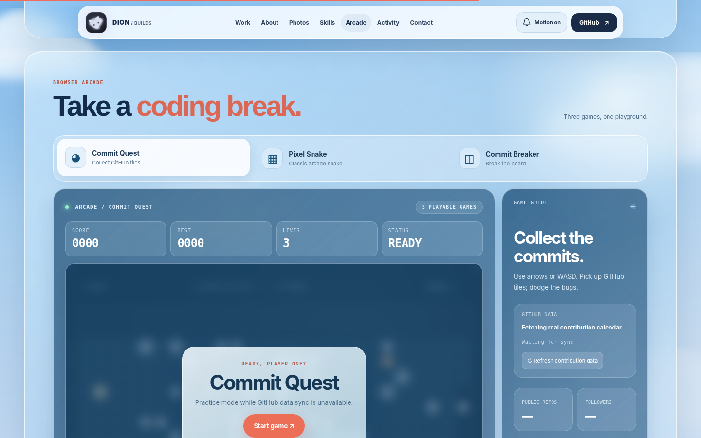
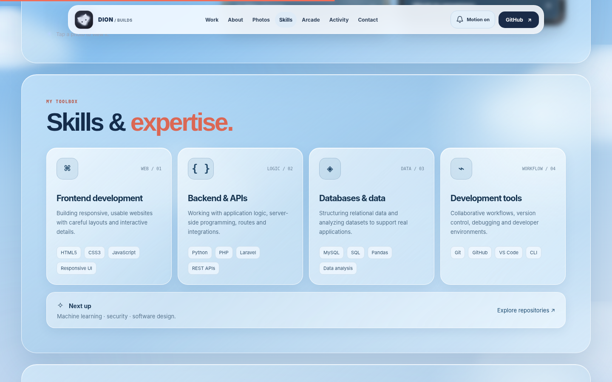

# Dion — Skybound Portfolio

An interactive portfolio for **Dion Agung Kadang**, built with HTML, CSS and JavaScript. A cloud-filled studio identity with playable games and real contribution data.

## Preview / Run locally

Extract the ZIP and run `JALANKAN_WEBSITE_LOKAL.bat` on Windows. Alternatively, open a terminal in this folder:

```powershell
py -m http.server 8000
```

Open **http://localhost:8000/**. No npm, shadcn, backend or build tooling is required for the website to run.

## Sections

- **Hero** — original animated cloud artwork, responsive type and cursor-responsive lettering.
- **Work** — draggable/keyboard-accessible project carousel with original HTML/CSS *illustrative mockups* for JIMNY COFFEE, Kriptofull, Transkriva and the Browser Arcade. These are concept illustrations, not screenshots of the final software.
- **About** — short introduction with a personal photo. The redundant developer-console card was removed.
- **Photos** — three existing personal photos with spotlight effects and accessible enlarge dialog.
- **Skills** — frontend, backend, databases and development tools.
- **Arcade** — Commit Quest, Pixel Snake and Commit Breaker. `game.js` retains the prior game rules and GitHub data integration, with a new canvas visual renderer, particle effects, and continuous paddle controls.
- **Activity** — GitHub contributions and recent public activity. `radar.js` and contribution workflow are kept intact.
- **Contact** — existing social links and the animated Quick Links footer.

### Animation notes

- Clouds float continuously (except with reduced-motion settings or Motion Off).
- Reveal animations replay when scrolling **up or down** (the observer never unregisters a section).
- Cursor particles stay **behind content**, and the site's hover effects cannot intercept clicks.
- The Motion bell switch actually turns site effects on or off.
- The project carousel supports button arrows, indicator buttons, mouse drag, and keyboard arrow keys.
- Reduced-motion OS preferences are respected.

### GitHub Pages

1. Put all project files directly in the root of the `dion1727.github.io` repository.
2. Commit and push to `main`.
3. Confirm **Settings → Pages → Deploy from a branch → main / (root)**.
4. Refresh the published page after the Pages deployment completes.

### Privacy

The three personal photos under `assets/moment-*.webp` are included from the previous portfolio and will be publicly visible if this project is deployed. Remove them before publishing if they should not be public.

## Project sources

Original CSS, interactions, game mechanics, GitHub sync, and user photos are based on the previous portfolio provided in the conversation. The new sky, cloud SVG illustration, project mockups and gallery behavior were written separately; no original images, art or source code were copied from the reference design studio.

**Main files:** `index.html`, `styles.css`, `skybound.css`, `glass-arcade-v8.css`, `site.js`, `skybound.js`, `game.js`, `radar.js`.

**React reference files:** `components/ui/` contains earlier React component references and `REACT_SHADCN_SETUP.md` describes optional migration. The deployed website does not require React or npm.


## V7 — Motion refinement

- Huruf judul hero menghindari cursor secara halus lalu kembali ke posisi asli.
- Animasi section diulang ketika scroll turun atau naik.
- Cursor ambient tetap berada di belakang tombol dan seluruh konten.
- Quick Links di footer memakai kontras warna yang terbaca.
- Cloud parallax bergerak pelan mengikuti scroll.
- Semua game, tiga foto, galeri, carousel, dan tautan sosial dari V6 tetap dipertahankan.

**Menjalankan secara lokal:** `py -m http.server 8000` dari folder ini, lalu buka `http://localhost:8000/`.


## V8 — Glass Arcade Rework

V8 keeps **the original Skybound V7 hero, animated clouds, cursor-following type, gallery, project carousel, Github activity, social links and three playable games** while polishing the sections that previously looked too black.

- Replaced the developer code-window with a personal photo card.
- Applied **translucent, sky-blue frosted glass** to Photos, Skills, Arcade, Activity and Contact. No more full-size nearly black slabs.
- Skills use brighter glass cards with improved contrast and hover movement.
- Arcade features three separate canvas designs: glowing contribution tiles and ghosts for **Commit Quest**; mint snake and pulsing food for **Pixel Snake**; coral-tinted bricks, trails and collision sparks for **Commit Breaker**.
- Added restrained particle bursts when collecting tiles, eating food or breaking bricks, plus score feedback.
- Fixed the Breaker paddle so **holding LEFT/RIGHT or A/D** continuously moves it. Touch direction buttons are supported.
- Kept local best scores and the existing GitHub contribution sync/fallback behavior.
- Retained scroll reveal both directions, cursor background swarm, parallax clouds and all three user photos.

### Controls

| Game | Keyboard | Touch |
|---|---|---|
| Commit Quest | Arrow keys / WASD | Direction pad |
| Pixel Snake | Arrow keys / WASD | Direction pad |
| Commit Breaker | Left / Right or A / D (hold) | Hold left/right pad |

Use the start, pause, sound, and speed controls below the arena. The website runs locally without npm or build tools.

### Previews





**Privacy:** `assets/moment-*.webp` are personal photos from the previous portfolio. If you publish this website, visitors can access them.
